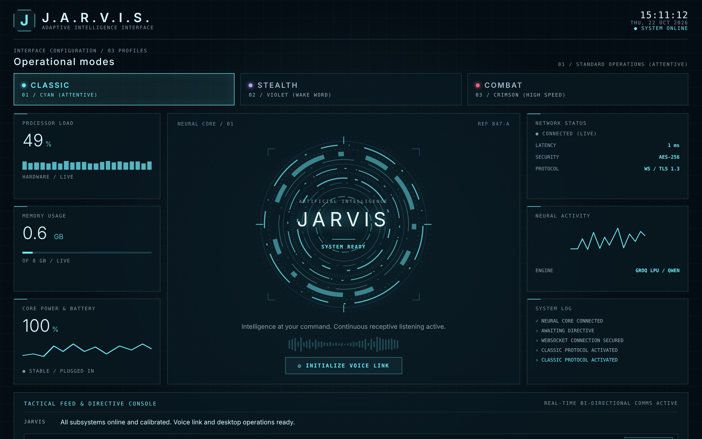
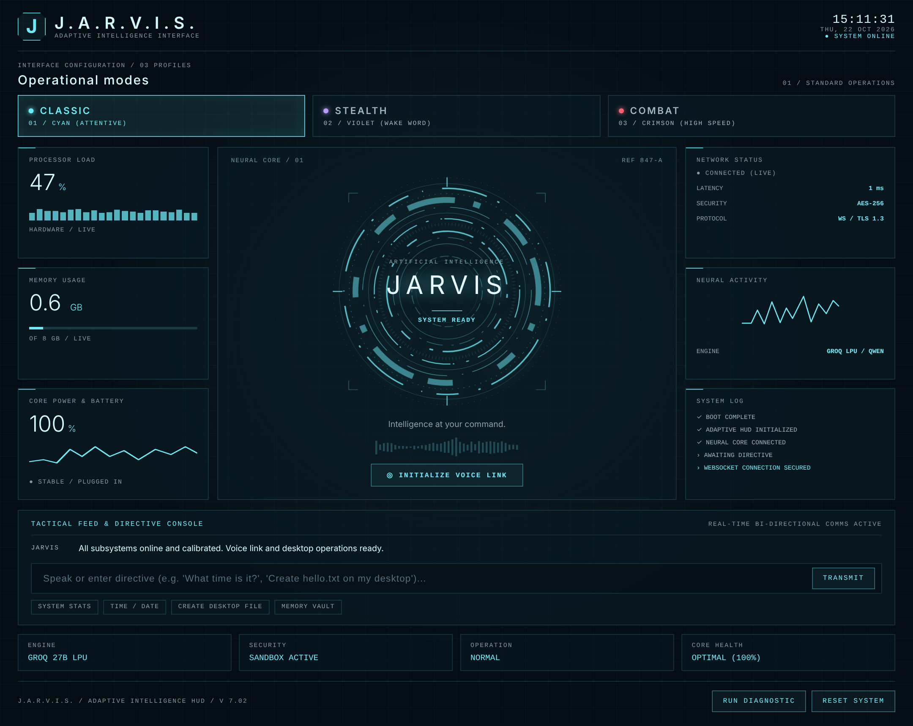
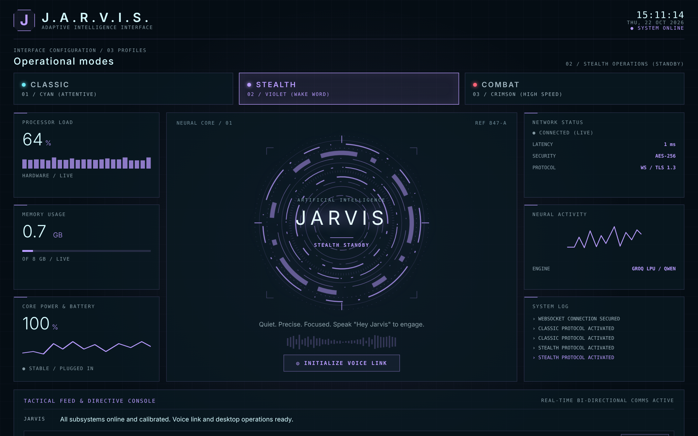
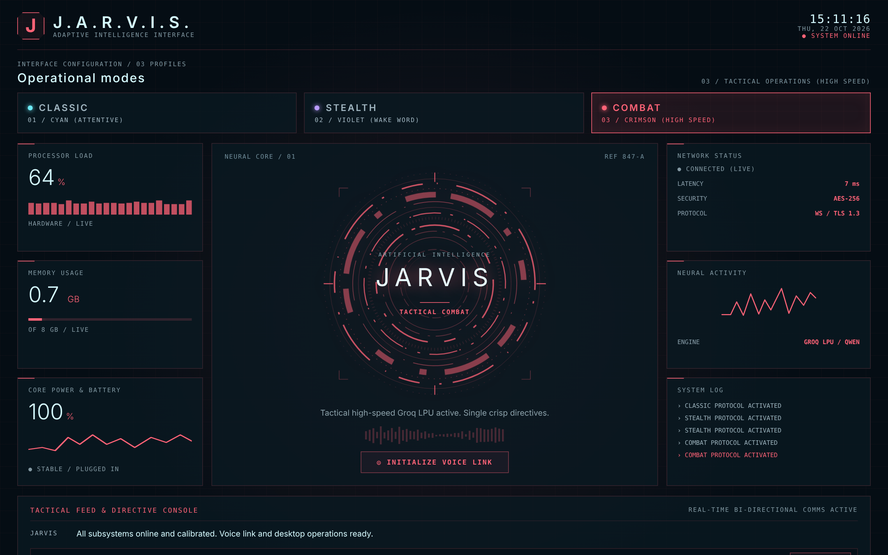
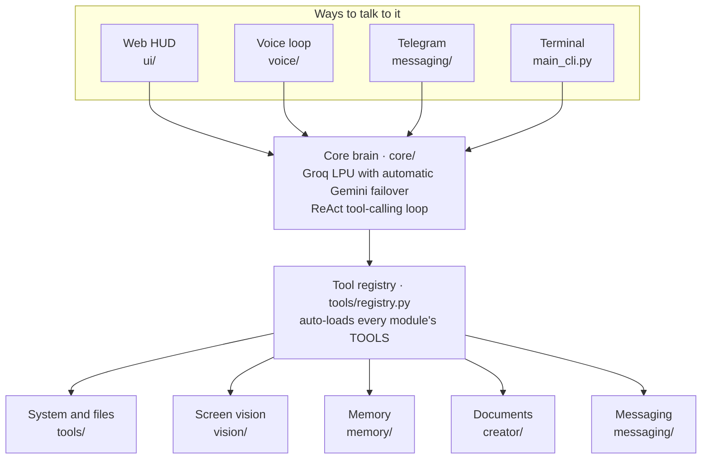

<div align="center">

# J.A.R.V.I.S.

### An autonomous desktop AI assistant that listens, sees, remembers and acts.

Talk to it, type to it, or message it from your phone. JARVIS opens apps, reads your screen,<br>
writes documents, keeps notes and answers in English, Hindi and Marathi.

<br>

[](https://www.python.org/)
[](https://fastapi.tiangolo.com)
[](https://groq.com)
[](https://ai.google.dev/)
[](https://github.com/SYSTRAN/faster-whisper)
[](https://github.com/rany2/edge-tts)
[](#quick-start)

<br>



</div>

<br>

## Contents

[Features](#features) · [Screenshots](#screenshots) · [How it is built](#how-it-is-built) · [Quick start](#quick-start) · [Running JARVIS](#running-jarvis) · [Testing](#testing) · [Project structure](#project-structure) · [Team](#team)

<br>

## Features

**Dual-engine brain.** Groq LPU runs `qwen/qwen3.8-27b` for fast reasoning and tool calling. If Groq hits a rate limit or quota (HTTP 429), JARVIS fails over to Google Gemini automatically, so a conversation never stalls. Replies adapt to the language you speak.

**Voice in three languages.** Speech-to-text runs locally with `faster-whisper` and stops listening after 1.5 seconds of silence. It detects English, Hindi and Marathi, and answers with matching neural voices through Edge-TTS. When you are offline, `pyttsx3` takes over.

**It can see your screen.** Ask "what's on my screen?" or "why is this error showing?" and JARVIS captures the display, compresses it and reads it with Gemini's multimodal model. One switch, `VISION_PAUSED=1`, turns all of that off.

**It operates your PC.** Launch apps by name (UWP protocols, PATH, registry, Start Menu shortcuts), read live CPU, RAM and battery, control windows, clipboard, volume, brightness and lock screen, type, press shortcuts, click and scroll, and run code. File access is confined to a sandbox.

**It remembers.** Notes and conversation history live in SQLite (WAL mode). Ask JARVIS to save something now and search for it next week.

**It writes documents.** The document engine builds PDF, Word and PowerPoint files in three themes (Clean Light, Dark Pro, Colourful), with Devanagari fonts bundled for Hindi and Marathi.

**It reaches your phone.** A Telegram bot lets you talk to JARVIS remotely. It only answers its owner.

**Three modes, one HUD.** Classic, Stealth and Combat change the colour, the pace of the animation and the character of the replies. See them below.

<br>

## Screenshots

The Web HUD is a single page served by FastAPI and wired to the brain over a WebSocket. Everything in it is live: CPU, memory and battery read from your machine, the log reports real connection events, and the console talks to the brain.

<div align="center">



<sub><b>Full dashboard.</b> Telemetry on the left, the neural reactor and voice link in the centre, network and system log on the right, and the directive console with quick chips underneath.</sub>

<br><br>

 

<sub><b>Stealth</b> (violet, wake word, slow and quiet) and <b>Combat</b> (crimson, high speed, short replies).</sub>

</div>

<br>

## How it is built



A message from any front end goes to the core brain. The brain decides whether to answer or call a tool, runs the tool through the registry, reads the result and carries on until it has an answer. Each module exposes its tools by listing them in a `TOOLS` variable, and the registry discovers them on start-up, so adding a capability never means touching the brain.

| Layer | What it uses |
| :-- | :-- |
| Brain | Groq (`qwen/qwen3.8-27b`, with `openai/gpt-oss` fallbacks) and Google Gemini through `google-genai`, with automatic quota failover |
| Server and HUD | FastAPI, WebSocket at `/ws/jarvis`, REST endpoints (`/health`, `/api/notes`, `/api/telemetry`, `/api/tools`, `/api/tts`, `/api/stt`), single-file HTML, CSS and JS front end |
| Voice | `faster-whisper` (base, CPU, int8), Edge-TTS, `pygame` playback, `pyttsx3` fallback |
| Vision | `mss` screen capture, JPEG downscaled to 1280px, Gemini multimodal analysis |
| Automation | `psutil`, `pyautogui`, Windows app discovery, sandboxed file tools (`tools/safety.py`) |
| Memory | SQLite in WAL mode through `aiosqlite` |
| Documents | ReportLab, python-docx, python-pptx |
| Messaging | `pyTelegramBotAPI` with an owner-only filter |

Design contracts live in [`ARCHITECTURE.md`](ARCHITECTURE.md) and the module ownership rules in [`AGENTS.md`](AGENTS.md).

<br>

## Quick start

You need Windows 10 or 11, Python 3.11 or 3.12, and Git.

```powershell
git clone https://github.com/Mercyy00/Project-A.git
cd Project-A

python -m venv venv
.\venv\Scripts\Activate.ps1

pip install -r requirements.txt
copy .env.example .env
```

Open `.env` and add at least one LLM key. Everything else has a sensible default.

```ini
GEMINI_API_KEY=your_gemini_api_key_here
GROQ_API_KEY=your_groq_api_key_here
GROQ_MODEL=qwen/qwen3.8-27b

# Optional
TELEGRAM_BOT_TOKEN=your_telegram_bot_token_here
TELEGRAM_OWNER_ID=your_telegram_chat_id_here
VISION_PAUSED=0
```

Never commit `.env`. It is already in `.gitignore`.

<br>

## Running JARVIS

| Interface | Command | Notes |
| :-- | :-- | :-- |
| **Web HUD** (recommended) | `python -m uvicorn ui.server:app --host 127.0.0.1 --port 8000` | Then open <http://127.0.0.1:8000> |
| **Voice loop** | `python main_voice.py` | Or double-click `run_jarvis_voice.bat` |
| **Terminal** | `python main_cli.py` | Plain text conversation with the brain |

<br>

## Testing

```powershell
pytest                                        # everything
pytest voice/test_stt.py voice/test_tts.py    # voice only
pytest tests/test_brain.py tests/test_tools.py tests/test_control_tools.py
```

Helper launchers in the repo root: `run_voice_tests.bat`, `run_audio_check.bat` (microphone and speaker check) and `run_benchmark.bat` (Whisper model benchmark, results in [`docs/voice_results.md`](docs/voice_results.md)).

<br>

## Project structure

```text
Project-A/
├── core/        Brain: Groq + Gemini failover, tool loop, async service
├── voice/       Speech-to-text, text-to-speech, language detection, benchmarks
├── vision/      Screen capture and Gemini screen understanding
├── tools/       Tool registry, app launcher, files, GUI control, windows, code runner
├── memory/      SQLite storage for notes and chat history
├── ui/          FastAPI server and the Web HUD (index.html)
├── creator/     PDF, Word and PowerPoint generation with themes
├── messaging/   Telegram bot with owner-only filter
├── docs/        Benchmarks and README screenshots
├── tests/       Test suite
├── main.py · main_cli.py · main_voice.py
└── ARCHITECTURE.md · AGENTS.md · requirements.txt · .env.example
```

<br>

## Team

JARVIS is built by eight engineers working in four pairs. Each pair owns its modules and works on its own feature branch.

| Pair | Engineer | Owns |
| :-- | :-- | :-- |
| A · Core, memory and UI | Jayesh (team lead) | `core/`, `main.py`, `main_cli.py`, `docs/` |
| | Rohit | `memory/`, `ui/` |
| B · Voice | Madhuri | Speech-to-text, language detection |
| | Akanksha | Text-to-speech |
| C · Tools and vision | Abhijit | `tools/` |
| | Aryan | `vision/` |
| D · Documents and messaging | Vidhita | `creator/` |
| | Trupti | `messaging/` |

<br>

<div align="center">
<sub>Built for the Project JARVIS AI Assistant Initiative.</sub>
</div>
