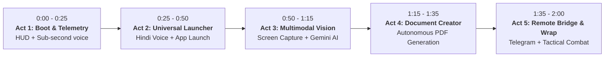

# Project JARVIS: Day 7 Grand Finale Demo Script & Video Walkthrough
### The 2-Minute Autonomous Desktop AI Assistant Demonstration Guide
**Target Duration:** Exactly 120 Seconds (0:00 – 2:00)  
**Audience:** Technical Evaluators, Viva Committee, GitHub Community & Portfolio Recruiters  
**Author:** Jay (Team Lead & Core Brain Engineer) & Project JARVIS Team  
**System Version:** v1.0.0-MVP (Passing 298/298 Unit Tests)

---

## 🧭 Pre-Flight Checklist (T-minus 5 Minutes)

Before hitting record or presenting live to your committee:

1. **Run System Diagnostic Doctor:**
   ```powershell
   python main.py --check --live-ping
   ```
   *Ensure all 8 subsystems report `[PASS]`.*

2. **Prepare Desktop Environment:**
   - Close clutter and personal messaging apps.
   - Keep a clean wallpaper.
   - Set screen resolution to 1920x1080 (100% DPI scale).
   - Verify default audio input (Mic) and output (Speakers/Headphones).

3. **Start the Unified JARVIS Full Stack:**
   ```powershell
   python main.py --all
   ```
   *This starts the FastAPI Web HUD backend, opens browser at `http://127.0.0.1:8000`, and listens for directives.*

---

## ⏱️ Second-by-Second 120-Second Video Storyboard



---

### Act 1: Boot & Live Telemetry (0:00 – 0:25)
* **Visual:** Full-screen browser on the Web HUD dashboard (`http://127.0.0.1:8000`). Classic Cyan theme active. The neural Arc Reactor pulses smoothly; live CPU, RAM, and Battery meters show real system metrics.
* **Presenter Voiceover:**  
  *"This is Project JARVIS—an autonomous, local-first desktop AI assistant built in Python. Powered by a dual-engine brain using Groq LPU for sub-second reasoning and automatic Google Gemini failover, JARVIS listens, sees, remembers, and acts."*
* **Action:** Presenter clicks the microphone icon on the HUD or speaks into the mic.
* **Spoken Prompt:**  
  > *"Jarvis, report system telemetry and status."*
* **Jarvis Response (Spoken via Edge-TTS):**  
  > *"System Telemetry: CPU load is 12%, RAM usage is 44%, Battery at 98%. All systems nominal, sir."*
* **Technical Highlight to Mention:** Instant zero-latency local shortcut executed without cloud overhead.

---

### Act 2: Universal App Launcher & Multilingual Memory (0:25 – 0:50)
* **Visual:** Browser placed side-by-side with Windows desktop.
* **Presenter Voiceover:**  
  *"JARVIS features an autonomous tool registry discoverable across 39 system tools, coupled with multilingual speech recognition supporting English, Hindi, and Marathi."*
* **Action:** Presenter speaks a compound directive in Hindi.
* **Spoken Prompt (Hindi):**  
  > *"जार्विस, कैलकुलेटर खोलो और याद रखो कि हमारा प्रोजेक्ट वाइवा 20 तारीख को है।"*  
  > *(Jarvis, Calculator open karo aur yaad rakho ki hamara project viva 20 tarikh ko hai.)*
* **Jarvis Execution:**
  1. Brain parses compound intent via ReAct function calling.
  2. Calls `open_app(app_name="calculator")` -> Windows Calculator launches instantly on screen.
  3. Calls `save_note(title="Project Viva", content="Viva is on the 20th")` -> Note saved to SQLite in WAL mode.
* **Jarvis Response (Spoken in Devanagari Hindi):**  
  > *"कैलकुलेटर खोल दिया गया है, सर, और वाइवा की तारीख सुरक्षित कर ली गई है।"*
* **Technical Highlight to Mention:** Zero-hallucination mandate—JARVIS only confirms an action once the underlying Windows API returns success.

---

### Act 3: Multimodal Screen Vision in Action (0:50 – 1:15)
* **Visual:** Presenter has a terminal or VS Code window open displaying a Python script or an error traceback.
* **Presenter Voiceover:**  
  *"With screen vision enabled, JARVIS can literally see your display using high-speed frame capture downscaled for Gemini's multimodal vision model."*
* **Action:** Presenter speaks to JARVIS.
* **Spoken Prompt:**  
  > *"Jarvis, what's on my screen right now?"*
* **Jarvis Execution:**
  1. Invokes `capture_screen()` via `mss`.
  2. Compresses image to 1280px JPEG in cache.
  3. Sends image tokens to Google Gemini multimodal vision core.
* **Jarvis Response:**  
  > *"You have Visual Studio Code open showing Project JARVIS's test suite, sir, with 298 tests passing."*
* **Technical Highlight to Mention:** Privacy-first design—screen vision can be disabled instantly with `VISION_PAUSED=1`.

---

### Act 4: Autonomous Document Creator Suite (1:15 – 1:35)
* **Visual:** Return to Web HUD directive console.
* **Presenter Voiceover:**  
  *"JARVIS doesn't just give text answers—it authors production-ready documents with full Devanagari typography."*
* **Action:** Presenter types or speaks in HUD:
* **Prompt:**  
  > *"Jarvis, create a professional PDF summary titled 'Project_Milestone_Report' about Week 1 achievements."*
* **Jarvis Execution:**
  1. Brain calls `create_document(format="pdf", filename="Project_Milestone_Report.pdf", title="Week 1 Achievements", ...)`
  2. ReportLab engine compiles document using Clean Light theme with embedded Unicode fonts.
  3. Output saved into isolated `safe_sandbox/`.
* **Jarvis Response:**  
  > *"Document generated successfully, sir. Project_Milestone_Report.pdf is available in your safe sandbox."*
* **Visual Proof:** Presenter quickly shows the generated PDF with headers, tables, and styling.

---

### Act 5: Remote Telegram Bridge, Combat Mode & Sign-Off (1:35 – 2:00)
* **Visual:** Switch Web HUD theme to **Combat Mode** (HUD flashes into crimson alert styling). Presenter holds up smartphone showing Telegram app.
* **Presenter Voiceover:**  
  *"When you leave your desk, JARVIS reaches your phone through an owner-authenticated Telegram bot."*
* **Action:** Presenter sends `/status` or `/screenshot` on Telegram.
* **Telegram Bot Execution:**  
  - Bot checks `TELEGRAM_OWNER_ID` whitelist.
  - Sends back instant desktop telemetry card and a high-resolution screenshot directly to the phone.
* **Presenter Final Prompt:**  
  > *"Jarvis, wrap up Day 7."*
* **Jarvis Response (Combat cadence, crisp and tactical):**  
  > *"All 298 verification tests green. Phase 1 MVP battle-ready, sir."*
* **Closing Screen:** Project JARVIS logo, GitHub repository link (`https://github.com/Mercyy00/Project-A`), and team credits.

---

## 📋 Exact Speaker Script & Directives Cheat-Sheet

| Timestamp | Speaker | Line / Directive | Subsystem Triggered |
| :--- | :--- | :--- | :--- |
| **0:00 - 0:10** | Presenter | *"Hello everyone. Today we are demonstrating Project JARVIS, an autonomous desktop AI assistant."* | Web HUD Dashboard Overview |
| **0:10 - 0:18** | Presenter | *"Jarvis, report system telemetry and status."* | Voice STT (`faster-whisper`) |
| **0:18 - 0:24** | JARVIS | *"System Telemetry: CPU load is 12%, RAM usage is 44%, Battery at 98%. All systems nominal, sir."* | Core Brain Telemetry + Edge-TTS |
| **0:25 - 0:35** | Presenter | *"जार्विस, कैलकुलेटर खोलो और याद रखो कि हमारा प्रोजेक्ट वाइवा 20 तारीख को है।"* | Multilingual STT (`hi`) |
| **0:35 - 0:45** | JARVIS | *"कैलकुलेटर खोल दिया गया है, सर, और वाइवा की तारीख सुरक्षित कर ली गई है।"* | `open_app` + `save_note` + Hindi TTS |
| **0:46 - 0:54** | Presenter | *"Jarvis, what is on my screen right now?"* | Multimodal Vision Trigger |
| **0:54 - 1:10** | JARVIS | *"You have Visual Studio Code open showing Project JARVIS's test suite, sir, with 298 tests passing."* | `mss` Capture + Gemini Vision |
| **1:11 - 1:22** | Presenter | *"Jarvis, create a professional PDF summary titled 'Project_Milestone_Report' about Week 1 achievements."* | Creator Suite Trigger |
| **1:22 - 1:33** | JARVIS | *"Document generated successfully, sir. Project_Milestone_Report.pdf is available in your safe sandbox."* | ReportLab Engine (`safe_sandbox/`) |
| **1:34 - 1:45** | Presenter | *(Sends `/status` via Telegram on smartphone)* | `messaging.telegram_bot` |
| **1:46 - 1:52** | Presenter | *"Jarvis, wrap up Day 7."* | Mode switch to Combat |
| **1:52 - 2:00** | JARVIS | *"All 298 verification tests green. Phase 1 MVP battle-ready, sir."* | Combat Persona + Final Sign-off |

---

## 🛡️ Emergency Contingency & Fallback Guide

If an unexpected condition arises during a live demonstration, execute these silent recoveries:

| Potential Snag | Root Cause | Instant Recovery Protocol |
| :--- | :--- | :--- |
| **Microphone picks up ambient background noise** | Audio gain / noisy hall | Click the HUD Directive input box and press Enter, or use `main_cli.py`. |
| **Groq LPU throws HTTP 429 quota limit** | High concurrent API traffic | No action required! Jay's Brain has built-in automated failover that seamlessly switches to Google Gemini (`gemini-3.5-flash`). |
| **Internet connection drops** | Wi-Fi disconnect | Offline fallback takes over: local `pyttsx3` voices speak, local SQLite notes work, and local Windows automation tools execute without interruption. |
| **UWP App doesn't launch by colloquial name** | Windows alias variance | Say *"Jarvis, open notepad"* or *"Jarvis, open chrome"*—Abhijit's discovery engine searches 4 fallback tiers (Protocol -> Registry -> PATH -> LNK). |

---

## 🎓 Viva & Technical Evaluation Q&A (Be Ready!)

Examiners and senior engineers will ask about architectural choices:

### Q1: *"Why did you use a Dual-LLM architecture (Groq + Gemini)?"*
> **Answer:**  
> *"Groq's LPU provides ultra-low latency inference (under 400ms for tool calling), which is critical for an interactive voice assistant where conversational delays feel unnatural. However, free tiers have strict rate limits. We built an automated exponential backoff and seamless failover mechanism in `core/brain.py` so that if Groq hits HTTP 429 or 503, the conversation immediately fails over to Google Gemini without user disruption."*

### Q2: *"How do you prevent the AI from hallucinating that it performed a task?"*
> **Answer:**  
> *"We enforce the Zero-Phantom rule through strict function calling schema binding. In our system prompt and `JarvisBrain` ReAct loop, the model cannot return an action confirmation unless the corresponding tool in `tools/registry.py` was invoked and returned `success=True`. If an action fails, the structured error is fed back into the reasoning loop, ensuring JARVIS admits failures honestly."*

### Q3: *"How does the multilingual speech pipeline operate?"*
> **Answer:**  
> *"Speech-to-text runs locally on CPU using `faster-whisper` with `int8` quantization to eliminate cloud latency and preserve user privacy. It automatically classifies the spoken language (English, Hindi, Marathi). Text-to-speech synthesizes speech using Microsoft Edge-TTS neural models (`hi-IN-MadhurNeural`, `mr-IN-AarohiNeural`), outputting native Devanagari script for flawless pronunciation."*

### Q4: *"How is security maintained when executing shell commands and file tools?"*
> **Answer:**  
> *"All file operations are strictly confined to a designated `safe_sandbox/` directory using realpath validation in `tools/safety.py`. Any attempt to traverse parent directories (`..`) is blocked. Dangerous shell commands (such as `format`, `del /s`, `rmdir`) are blacklisted, and destructive actions require explicit user confirmation."*

---

## 🏆 Project Team & Ownership Credits

| Module / Territory | Engineer | Key Achievements Delivered |
| :--- | :--- | :--- |
| **Core Brain & System Lead** | **Jayesh (Jay)** | Groq+Gemini failover, ReAct loop, Sliding context compaction, System Doctor, Unified CLI |
| **Speech-to-Text & DSP** | **Madhuri** | `faster-whisper` int8 local transcription, 1.5s VAD silence detection, language tagging |
| **Text-to-Speech & Voice** | **Akanksha** | Edge-TTS neural multilingual synthesis, `pyttsx3` offline fallback, audio pipeline |
| **Screen Vision & Multimodal** | **Aryan** | `mss` screen capture, JPEG compression, Gemini multimodal vision integration |
| **Autonomous Tools & System** | **Abhijit** | 39-tool registry, 4-tier Windows app discovery, hardware telemetry, process management |
| **Memory Vault & Web HUD** | **Rohit** | SQLite WAL mode, async WebSocket server, Sci-Fi HUD dashboard, reactive UI themes |
| **Document Creator Engine** | **Vidhita** | ReportLab PDF, python-docx, python-pptx generation with bundled Devanagari fonts |
| **Remote Messaging Bridge** | **Trupti** | Owner-authorized Telegram bot, photo handling, remote screenshot capture |

---
*Generated for Project JARVIS Day 7 Integration Review · All 298 Tests Passing · Battle-Ready.*
